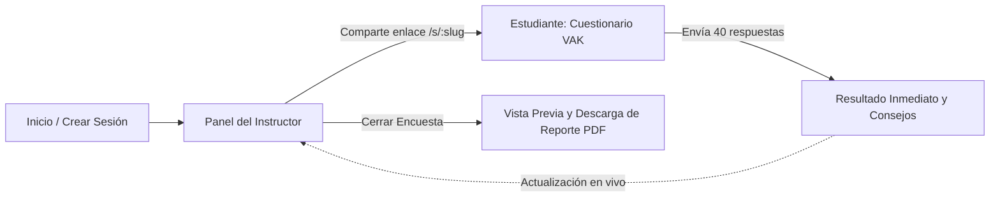

# Plataforma VAK • Diagnóstico de Estilos de Aprendizaje

> Sistema web moderno, interactivo y profesional para la evaluación de canales de percepción sensorial (**Visual, Auditivo y Cinestésico**) basado en el modelo neurolingüístico VAK, con monitoreo en tiempo real y exportación de reportes ejecutivos en PDF de calidad editorial.

---

## 📋 Tabla de Contenidos

- [Características Principales](#-características-principales)
- [Arquitectura y Stack Tecnológico](#-arquitectura-y-stack-tecnológico)
- [Estructura del Proyecto](#-estructura-del-proyecto)
- [Instalación y Uso Local](#-instalación-y-uso-local)
- [Flujo de Funcionamiento](#-flujo-de-funcionamiento)
- [Generador de Reportes PDF](#-generador-de-reportes-pdf)
- [Pruebas Automatizadas](#-pruebas-automatizadas)
- [Despliegue en Producción](#-despliegue-en-producción)

---

## ✨ Características Principales

- **Cuestionario Psicométrico Validado**: 40 reactivos interactivos con mapeo determinista hacia los 3 canales de aprendizaje (Visual, Auditivo y Cinestésico).
- **Diseño Visual Premium y Responsivo**: Interfaz moderna con tipografía *Plus Jakarta Sans*, microinteracciones fluidas, soporte para dispositivos móviles, tablets y escritorios, y respeto estricto a `prefers-reduced-motion`.
- **Panel del Instructor en Tiempo Real**:
  - Enlace de invitación con copiado en 1 clic y notificaciones flotantes (*Toasts*).
  - Indicador de estado en vivo con punto pulsante.
  - Tarjetas KPI con promedios grupales calculados dinámicamente.
  - Buscador reactivo para filtrar estudiantes en la tabla sin recargar.
  - Botón de **Reinicio de Encuesta** para reutilizar la sesión o limpiar registros.
- **Experiencia del Estudiante**:
  - Registro ágil y bienvenida personalizada.
  - Barra superior flotante de progreso en tiempo real con porcentaje y conteo de reactivos.
  - Alerta inteligente con desplazamiento suave al primer reactivo pendiente si se intenta enviar incompleto.
  - Pantalla final de resultados con felicitación personalizada, porcentajes por canal, barras comparativas horizontales animadas y guía pedagógica con consejos de estudio según su estilo predominante.
- **Reporte Ejecutivo en PDF (A4)**:
  - Diseño editorial profesional listo para entregar a clientes, comités o evaluadores.
  - Encabezado institucional, metadatos estructurados y 4 tarjetas KPI con promedios grupales.
  - Franja de orientación pedagógica automatizada con recomendaciones para el docente según el estilo dominante del grupo.
  - Tabla de participantes paginada dinámicamente (reimpresión automática de cabeceras, sin hojas en blanco innecesarias).
  - Modal interactivo de **Vista Previa de PDF** integrado en la aplicación antes de descargar.
- **Almacenamiento Efímero en Memoria (`:memory:`)**:
  - Operación en memoria RAM por defecto: sin archivos de base de datos que mantener ni problemas de permisos en la nube. El reporte PDF constituye el documento consolidado oficial.

---

## 🛠 Arquitectura y Stack Tecnológico

| Capa | Tecnología | Descripción |
| :--- | :--- | :--- |
| **Backend** | [Node.js](https://nodejs.org/) & [Express 5](https://expressjs.com/) | Servidor HTTP RESTful liviano y de alto rendimiento. |
| **Motor de Base de Datos** | [better-sqlite3](https://github.com/WiseLibs/better-sqlite3) | SQLite embebido ejecutándose en memoria (`:memory:`) por defecto. |
| **Motor de PDF** | [PDFKit](https://pdfkit.org/) | Generación vectorial de documentos A4 con cálculo de páginas en búfer (`bufferPages`). |
| **Frontend** | HTML5 Semántico + Vanilla JavaScript (ES6+) | Lógica de cliente ligera, sin dependencias de frameworks pesados. |
| **Estilos** | CSS Moderno | Variables CSS (Design Tokens), Flexbox, CSS Grid, Glassmorphism y animaciones fluidas. |
| **Tipografía e Iconos** | Google Fonts (*Plus Jakarta Sans*) + SVG Icons | Iconografía vectorial propia inspirada en Lucide y Favicon temático VAK. |

---

## 📂 Estructura del Proyecto

```text
test_aprendizaje/
├── .gitignore               # Exclusiones de Git (node_modules, logs, temporales)
├── package.json             # Metadatos del proyecto, scripts y dependencias
├── server.js                # Servidor Express, enrutador de vistas y API REST
├── public/                  # Archivos estáticos servidos al navegador
│   ├── favicon.svg          # Favicon vectorial temático de canales VAK
│   ├── index.html           # Landing page y creación de sesión de instructor
│   ├── instructor.html      # Panel de control del instructor con KPIs y modal PDF
│   ├── session.html         # Cuestionario interactivo del estudiante y resultados
│   ├── styles.css           # Sistema de diseño, tokens, responsividad y componentes
│   └── app.js               # Lógica de cliente, modales, validaciones y toasts
├── src/                     # Módulos centrales de lógica de negocio y datos
│   ├── db.js                # Capa SQLite en memoria y operaciones CRUD
│   ├── logic.js             # Mapeo y cálculo psicométrico de los 40 reactivos VAK
│   ├── questions.js         # Banco oficial de preguntas y opciones del test
│   └── pdfReport.js         # Generador de reportes ejecutivos en PDF
└── test/                    # Suite de pruebas automatizadas
    ├── logic.test.js        # Pruebas del cálculo de puntajes y empates
    └── pdfReport.test.js    # Pruebas del generador de PDF y estadísticas grupales
```

---

## 🚀 Instalación y Uso Local

### 1. Prerrequisitos
- [Node.js](https://nodejs.org/) (versión 18 o superior recomendada).
- npm (incluido con Node.js).

### 2. Clonar el repositorio e instalar dependencias
```bash
git clone <URL_DEL_REPOSITORIO>
cd test_aprendizaje
npm install
```

### 3. Iniciar el servidor
```bash
npm start
```
La aplicación quedará disponible en:
👉 **`http://localhost:3000`**

---

## 🔄 Flujo de Funcionamiento



1. **Creación de la Sesión**: El docente ingresa su nombre, programa académico y ficha/grupo en `http://localhost:3000`.
2. **Distribución del Enlace**: El sistema genera una URL única (ej.: `/s/sess-xxxx`) que el instructor copia en un clic.
3. **Evaluación de Estudiantes**: Cada estudiante ingresa su nombre completo, responde los 40 reactivos y visualiza al instante su porcentaje de predominancia con recomendaciones didácticas.
4. **Monitoreo y Cierre**: El instructor supervisa la participación en vivo desde `/panel/sess-xxxx`. Al finalizar la clase, pulsa **Cerrar Encuesta**.
5. **Emisión de PDF**: Se habilitan los botones de **Vista Previa PDF** (modal interactivo) y **Descargar PDF** con el informe institucional consolidado.

---

## 📄 Generador de Reportes PDF

El documento exportado cuenta con:
- **Formato A4** con márgenes equilibrados y tipografía limpia.
- **Branding Institucional**: Franja en azul noche (`#0F172A`) y acento cobalto (`#3B82F6`).
- **Bloque de Metadatos**: Instructor, Asignatura/Programa, Grupo y Fecha formal en español.
- **Métricas Ejecutivas**: Promedios porcentuales de Visual, Auditivo y Cinestésico, junto con el total y tasa de finalización.
- **Recomendaciones Didácticas**: Sugerencias pedagógicas adaptadas al canal dominante del grupo evaluado.
- **Tabla Oficial Paginada**: Con códigos de color por estilo, números de lista y filas alternadas con efecto cebra.
- **Paginación Dinámica**: Ajuste automático sin páginas en blanco sobrantes (1 estudiante = 1 página exacta; múltiples estudiantes = páginas proporcionales con reimpresión de cabeceras).

---

## 🧪 Pruebas Automatizadas

El proyecto cuenta con pruebas unitarias nativas de Node.js (`node:test`):

```bash
npm test
```

Verificaciones ejecutadas:
- Integridad del total de 40 puntos y suma del 100% en porcentajes.
- Detección precisa de empates y perfiles multimodales.
- Cálculo de promedios grupales con datos vacíos y con respuestas completadas.
- Traducción al español de estilos predominantes.
- Generación de flujo PDF válido (`%PDF-1.3`).

---

## ☁️ Despliegue en Producción

Gracias a su arquitectura autónoma con base de datos en memoria (`:memory:`), la aplicación no requiere aprovisionar bases de datos externas ni configurar volúmenes persistentes:

1. Configura el comando de inicio en tu proveedor de nube (Render, Railway, Fly.io, etc.):
   ```bash
   node server.js
   ```
2. Asegúrate de exponer la variable de entorno `PORT` (manejada automáticamente por la mayoría de servicios de hosting).
3. *(Opcional)* Si deseas persistir los datos en un archivo SQLite local en lugar de memoria, define la variable de entorno:
   ```bash
   PERSIST_DB=true
   ```

---

## 📄 Licencia

Este proyecto se distribuye bajo la licencia **ISC**.
